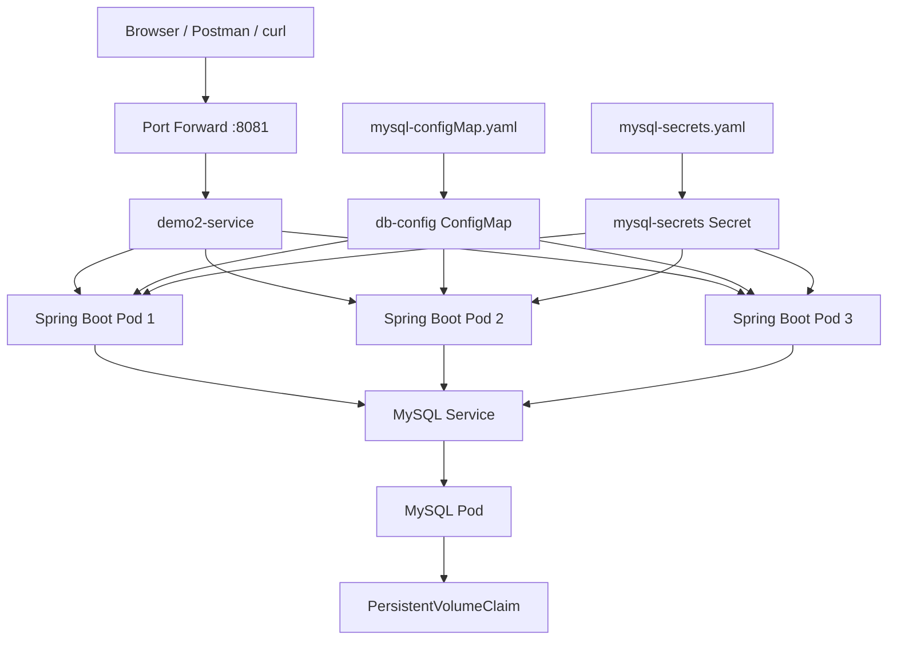

# Spring Boot + MySQL on Kubernetes

Deploy a Dockerized Spring Boot application with MySQL on a local Kubernetes cluster using Minikube.

## Architecture



## Tech Stack

- Java 17
- Spring Boot 4.1.1
- Spring Data JPA / Hibernate
- MySQL 9.7
- Docker
- Kubernetes
- Minikube
- Maven

## Project Files

| File | Purpose |
|---|---|
| `Dockerfile` | Builds the Spring Boot application image |
| `mysql-configMap.yaml` | Stores database host and database name |
| `mysql-secrets.yaml` | Stores database username and password |
| `db-deployment.yaml` | Deploys MySQL and configures persistent storage |
| `app-deployment.yaml` | Deploys the Spring Boot application and service |

## Kubernetes Resources

| Resource | Name |
|---|---|
| Application Deployment | `demo2-deployment` |
| Application Service | `demo2-service` |
| MySQL Deployment | `mysql-deployment` |
| MySQL Service | `mysql` |
| Database ConfigMap | `db-config` |
| MySQL Secret | `mysql-secrets` |
| MySQL PVC | `mysql-pv-claim` |

The application runs **3 replicas** on port `8081`. MySQL uses a PersistentVolumeClaim to retain database data.

## Run on Minikube

### 1. Start Minikube

```bash
minikube start
```

### 2. Build the Spring Boot application

```bash
mvn clean package -DskipTests
```

### 3. Build the Docker image inside Minikube

```bash
minikube image build -t demo2:1.0 .
```

### 4. Create the ConfigMap and Secret

```bash
kubectl apply -f mysql-configMap.yaml
kubectl apply -f mysql-secrets.yaml
```

- **ConfigMap:** Provides `DB_HOST` and `DB_NAME`.
- **Secret:** Provides `DB_USERNAME` and `DB_PASSWORD`.

### 5. Deploy MySQL

```bash
kubectl apply -f db-deployment.yaml
```

Check that MySQL is running:

```bash
kubectl get pods
kubectl get pvc
```

### 6. Deploy the Spring Boot application

```bash
kubectl apply -f app-deployment.yaml
```

Check the deployment:

```bash
kubectl get deployments
kubectl get pods
kubectl get services
```

Confirm that all three application replicas are available.

## Access the Application

### Option A — Port Forwarding

```bash
kubectl port-forward service/demo2-service 8081:8081
```

Keep the terminal running, then use:

**API endpoint:** `http://localhost:8081/api/registrations`

### Option B — NodePort

Find the Minikube IP and service port:

```bash
minikube ip
kubectl get service demo2-service
```

The current NodePort is `30902`, so the API URL is:

`http://192.168.49.2:30902/api/registrations`

The IP and NodePort may differ in another Minikube environment.

## Test the API

### Get all registrations

```bash
curl http://localhost:8081/api/registrations
```

### Create a registration

Send a `POST` request to:

`http://localhost:8081/api/registrations`

Example JSON body:

```json
{
  "email": "dil@example.com",
  "username": "dil",
  "password": "example-password"
}
```

Use Postman with **Body → raw → JSON** and set the method to `POST`.

## Rebuild After Code Changes

```bash
mvn clean package -DskipTests
minikube image build -t demo2:1.0 .
kubectl rollout restart deployment/demo2-deployment
kubectl rollout status deployment/demo2-deployment
```

## Useful Commands

```bash
# View pods
kubectl get pods

# View application logs
kubectl logs deployment/demo2-deployment --tail=40

# Inspect application environment variables
kubectl describe deployment demo2-deployment

# Check service endpoints
kubectl get endpoints demo2-service

# Check persistent storage
kubectl get pvc

# View ConfigMap and Secret
kubectl get configmap db-config
kubectl get secret mysql-secrets
```

## Notes

- Kubernetes injects database settings into the application through environment variables.
- The ConfigMap stores non-sensitive database configuration; the Secret stores credentials.
- Base64-encoded Kubernetes Secret values are **not encrypted**.
- Do not commit real database passwords or other secrets to a public GitHub repository. Keep actual credentials out of version control.
- Hibernate uses `ddl-auto: update` to update the database schema.
- The MySQL PersistentVolumeClaim preserves data when the MySQL pod is recreated.
- `kubectl port-forward` must remain running while using the forwarded URL.
