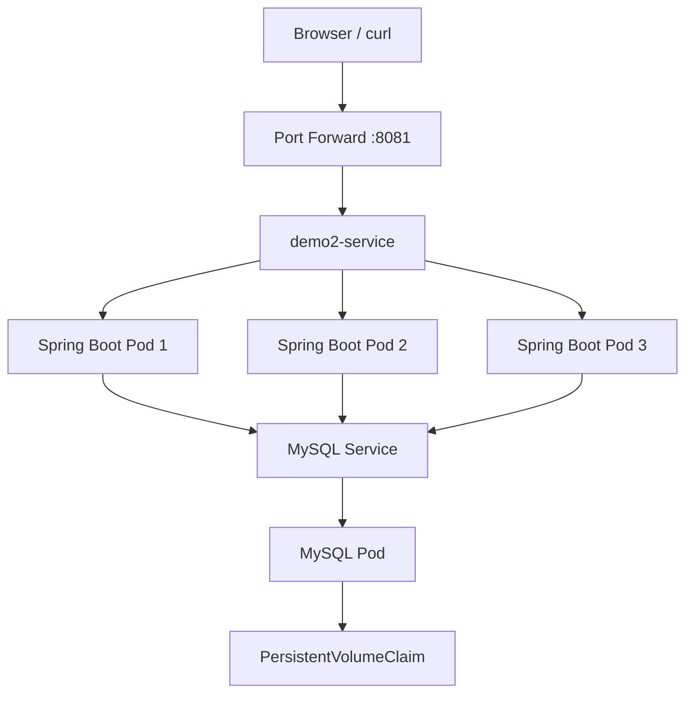

# Spring Boot + MySQL on Kubernetes

Deploy a Dockerized Spring Boot application with MySQL on a local Kubernetes cluster using Minikube.

## Architecture



## Tech Stack

- Java 17
- Spring Boot 4.1.1
- Spring Data JPA / Hibernate
- MySQL 9.7
- Docker
- Kubernetes
- Minikube
- Maven

## Kubernetes Resources

| Resource | Name |
|---|---|
| Application Deployment | `demo2-deployment` |
| Application Service | `demo2-service` |
| MySQL Deployment | `mysql-deployment` |
| MySQL Service | `mysql` |
| Database ConfigMap | `db-config` |
| MySQL Secret | `mysql-secrets` |
| MySQL PVC | `mysql-pv-claim` |

The application runs **3 replicas** on port `8081`. MySQL uses a PersistentVolumeClaim for data storage.

## Run Locally on Minikube

### 1. Start Minikube

```bash
minikube start
```

### 2. Build the application

```bash
mvn clean package -DskipTests
```

### 3. Build the Docker image inside Minikube

```bash
minikube image build -t demo2:1.0 .
```

### 4. Apply Kubernetes configuration

```bash
kubectl apply -f db-deployment.yaml
kubectl apply -f app-deployment.yaml
```

Ensure `db-config` and `mysql-secrets` have been created and configured before deploying the application.

### 5. Check the resources

```bash
kubectl get pods
kubectl get deployments
kubectl get services
kubectl get pvc
```

### 6. Access the application

**Option A — Port forwarding**

```bash
kubectl port-forward service/demo2-service 8081:8081
```

Open: http://localhost:8081/

**Option B — NodePort**

```bash
minikube ip
kubectl get service demo2-service
```

Use the Minikube node IP and the NodePort shown by the service command:

```text
http://<MINIKUBE-IP>:<NODE-PORT>
```

The current setup uses NodePort `30902`, so the address is:

`http://192.168.49.2:30902`

This address depends on the current Minikube environment.

## Verify the Application

```bash
curl -v http://localhost:8081/
```

Expected response:

```text
hello
```

## Rebuild After Code Changes

```bash
mvn clean package -DskipTests
minikube image build -t demo2:1.0 .
kubectl rollout restart deployment/demo2-deployment
kubectl rollout status deployment/demo2-deployment
```

## Useful Commands

```bash
kubectl get pods
kubectl logs deployment/demo2-deployment --tail=40
kubectl describe deployment demo2-deployment
kubectl get endpoints demo2-service
kubectl get pvc
```

## Notes

- The application connects to MySQL using Kubernetes environment variables.
- Database connection settings are supplied through a ConfigMap and Secret.
- The application uses Hibernate `ddl-auto: update`.
- Do not commit real database passwords or other secrets to GitHub.
- `kubectl port-forward` must remain running while using the forwarded URL.

